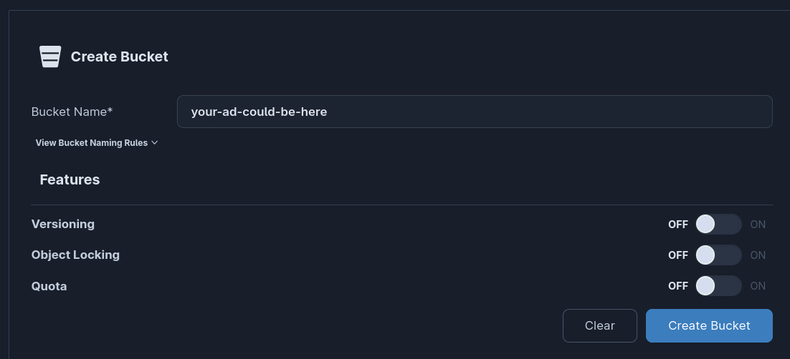
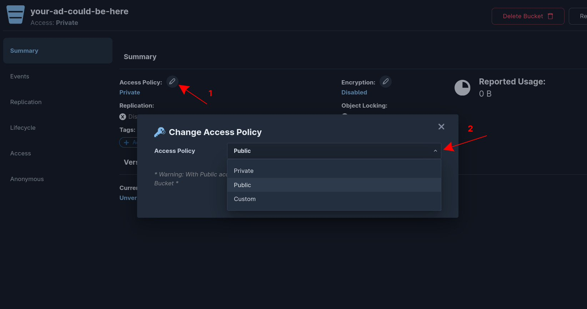
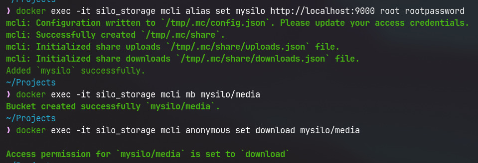
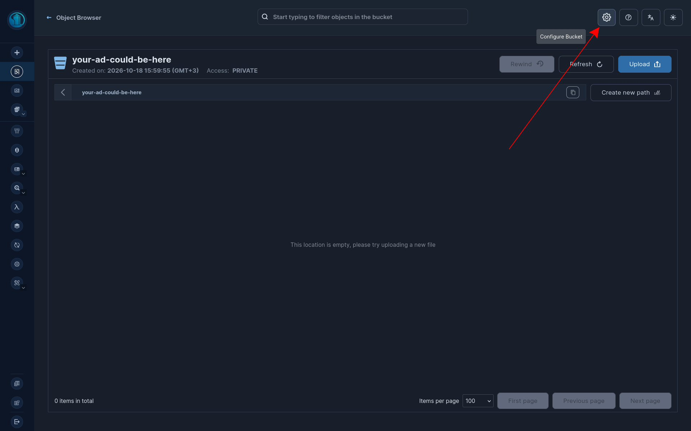
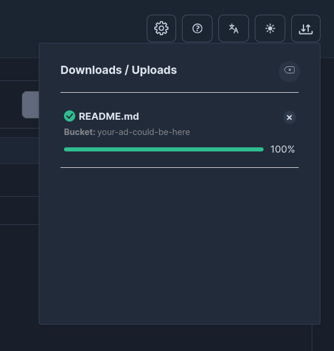

# Руководство: Развертывание Silo (S3-совместимое объектное хранилище)


Давным-давно, в 90-х годах, появился интернет-книжный - Amazon. Спустя десятилетие Amazon представила AWS (Amazon Web Services), в состав которых вошёл и S3. S3 - это прекрасно масштабируемое хранилище данных, которое полюбили разработчики. Взяв его интерфейс и идею, люди наплодили некоторое количество S3-подобных сервисов и стали повмеместно их использовать.

Одним из таких сервисов является Silo - продолжение (*[Minio](/tutorials/minio/MinIO_bucket_setup_ReadMe.md) — deprecated*). Именно его мы и будем использовать в курсе для хранения файлов.

**Silo** ([pgsty/silo](https://github.com/pgsty/silo)) — это активно поддерживаемый форк MinIO, полностью совместимый с протоколом Amazon S3.

---

## 1. Запуск Silo через Docker Compose

Создайте (или дополните существующий) файл `docker-compose.yml` в корне вашего проекта:

```yaml
services:
  silo:
    container_name: silo_storage
    image: pgsty/silo:latest
    ports:
      - "9000:9000" # S3 API
      - "9001:9001" # Веб-консоль управления
    environment:
      MINIO_ROOT_USER: root
      MINIO_ROOT_PASSWORD: rootpassword
      MINIO_CONSOLE_ADDRESS: ":9001"
    volumes:
      - silo-data:/data
    command: server /data --console-address ":9001"

volumes:
  silo-data:
```

Запустите контейнер командой:

```bash
docker compose up -d
```

После старта будут доступны два порта:
* `http://localhost:9000` — адрес S3 API (для бэкенда и прямых ссылок на файлы).
* `http://localhost:9001` — веб-интерфейс (Console) Silo.

---

## 2. Создание бакета и настройка публичного доступа

По умолчанию все создаваемые корзины (бакеты) приватны: получить файл по прямой HTTP-ссылке без подписи запроса или токена невозможно. Для лабораторных работ требуется сделать бакет публичным на чтение, чтобы фронтенд и браузер могли загружать картинки и видео по прямым URL.

Вы можете настроить бакет **одним из двух способов**: через **Веб-интерфейс (GUI)** или через **консоль (CLI)**.

---

### Способ 1: Настройка через GUI (веб-консоль)

1. Откройте в браузере консоль управления: [`http://localhost:9001`](http://localhost:9001).
2. Авторизуйтесь под учетной записью администратора:
   * **Username:** `root`
   * **Password:** `rootpassword`
3. В левом меню перейдите в раздел **Buckets** и нажмите кнопку **Create Bucket**:
   * Введите имя бакета (например, `media`, либо название по вашей теме: `auto-media`, `hotel-images` и т.п.).
   * Нажмите **Create Bucket**.



4. Перейдите в настройки созданного бакета (шестерёнка в правом верхнем углу).
5. **Делаем бакет публичным:**
   В верхней части страницы бакета найдите пункт **Access Policy** (по умолчанию `Private`). Нажмите на него, выберите `Public` и сохраните изменения (**Set**).



6. Готово! Теперь объекты в этой корзине доступны анонимным пользователям по прямой ссылке.

---

### Способ 2: Настройка через CLI (`mcli` / `mc`)

Внутри Docker-образа `pgsty/silo` уже предустановлен консольный клиент `mcli` (а также alias `mc`). Выполните команды в терминале:

1. **Создание псевдонима подключения к локальному серверу Silo:**

```bash
docker exec -it silo_storage mcli alias set mysilo http://localhost:9000 root rootpassword
```

2. **Создание бакета:**
*(замените `media` на имя вашей корзины при необходимости)*

```bash
docker exec -it silo_storage mcli mb mysilo/media
```

3. **Открытие публичного анонимного доступа на чтение:**

```bash
docker exec -it silo_storage mcli anonymous set download mysilo/media
```



> **Примечание:** 
> * Политика `download` предоставляет доступ на чтение (GET) без авторизации, не выдаём лишних полномочий, если не требуется
> * Но если всё же требуется доступ и на запись, можно указать `public` (`mcli anonymous set public mysilo/media`).

---

## 3. Загрузка файлов и проверка ссылок

1. Откройте веб-консоль [`http://localhost:9001`](http://localhost:9001), перейдите в раздел **Buckets** -> ваш бакет (`media`). Если оказались на странице конфигурации - нажимаем на иконку папки в правом верхнем углу.



2. Нажмите **Upload** и загрузите изображения и видео для ваших карточек.



3. Прямая ссылка на файл формируется по правилу:
   ```text
   http://localhost:9000/<имя-бакета>/<имя_файла>.<расширение>
   ```
   Например:
   ```text
   http://localhost:9000/media/car.jpg
   http://localhost:9000/media/preview.mp4
   ```
